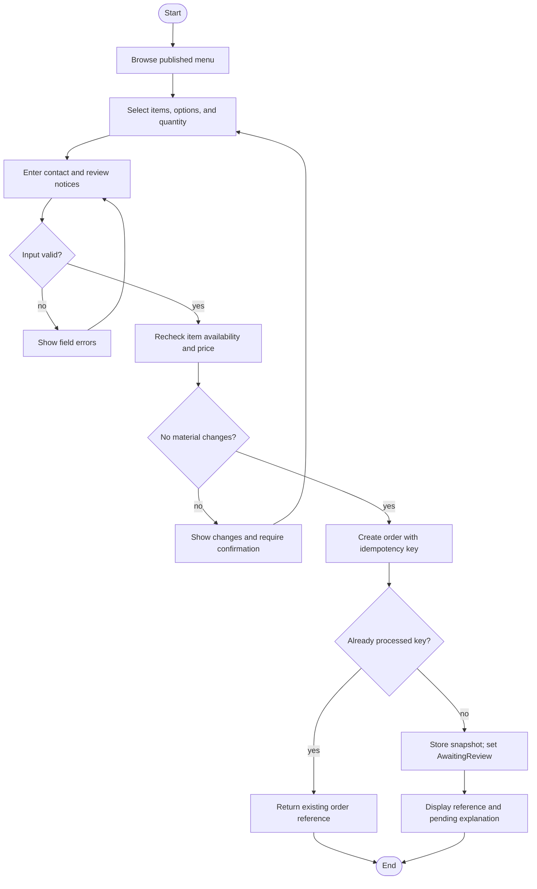

# Activity View — Submit Pickup Request

## Activity notes

- Validation before persistence avoids creating partial orders.
- Final availability and price checks address the time gap between menu browsing and submission.
- Idempotency handles transport retries; it does not merge two intentional orders.
- The diagram omits internal authentication, logging, and notification retries to keep its focus on the customer goal.
