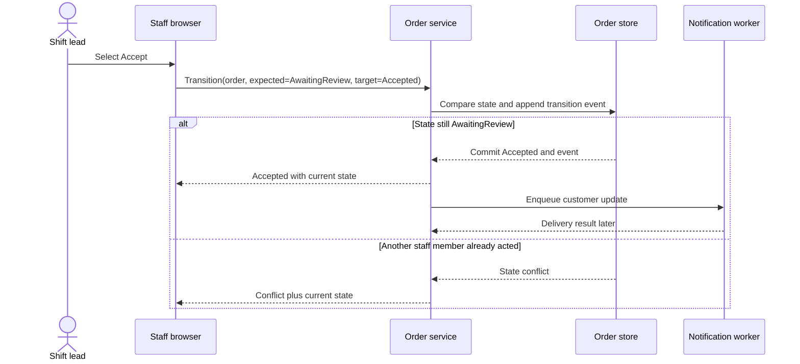

# Sequence View — Staff Accepts an Order

## Sequence notes

The store performs a compare-and-transition so two staff actions cannot both win based on stale screens. The customer notification is queued only after the state is committed. Delivery failure requires retry and staff visibility; it does not revert the accepted state.
