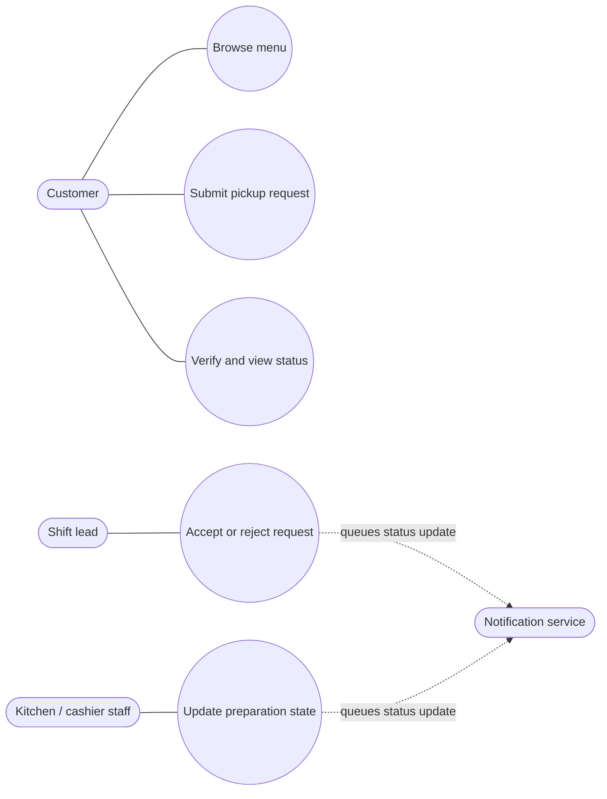

# Use-Case View — Pickup Ordering

## Boundary and assumptions

- The system boundary is the online ordering service. Existing POS and payment tools are outside the first-release boundary.
- The notification service is an external supporting actor. Delivery can fail independently of order persistence.
- “Submit pickup request” ends in `AwaitingReview`; staff acceptance is a separate use case.
- The customer may browse without an account; order retrieval requires reference plus one-time verification.

## Why this view

Use it to agree who interacts with the service and which goals belong in scope. It does not show sequence, data structure, or every error path; use the activity and sequence views for those questions.
